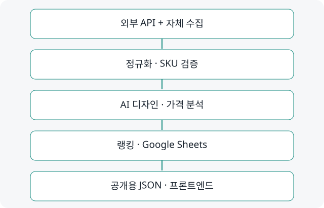
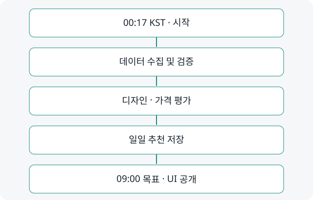

# 개발 기록

- v0.1: Google Sheets 16개 관리 탭, 기본 수집 인터페이스, 랭킹, FastAPI.
- v0.2: 이미지 평가 호출 코드, 상대 가격 분석, 상품 저장, 비활성 일일 워크플로 및 CI.
- v0.3: 공개 정적 사이트, 상품 검색/필터/정렬/로컬 저장, 개발 기록, Pages 배포 워크플로.

## 구조

## 실행
로컬: Python 의존성 설치 후 pytest, pipeline.py, uvicorn api:app. 실제 수집은 인증 및 제공처 연동 필요. 정적 사이트는 site 폴더에서 python -m http.server 8080 실행(개발 기록 SVG는 먼저 복사). Pages는 Settings → Pages → GitHub Actions 설정 필요.

## 데이터 보안
공개 사이트는 허가된 공개용 JSON만 제공. Google Sheets 인증키, API 토큰, 원본 상품 DB를 노출하지 않는다. 현재 references.json은 빈 상태. 실데이터 자동 내보내기는 미구현이며 공개 권한 검토 후 연결한다.
